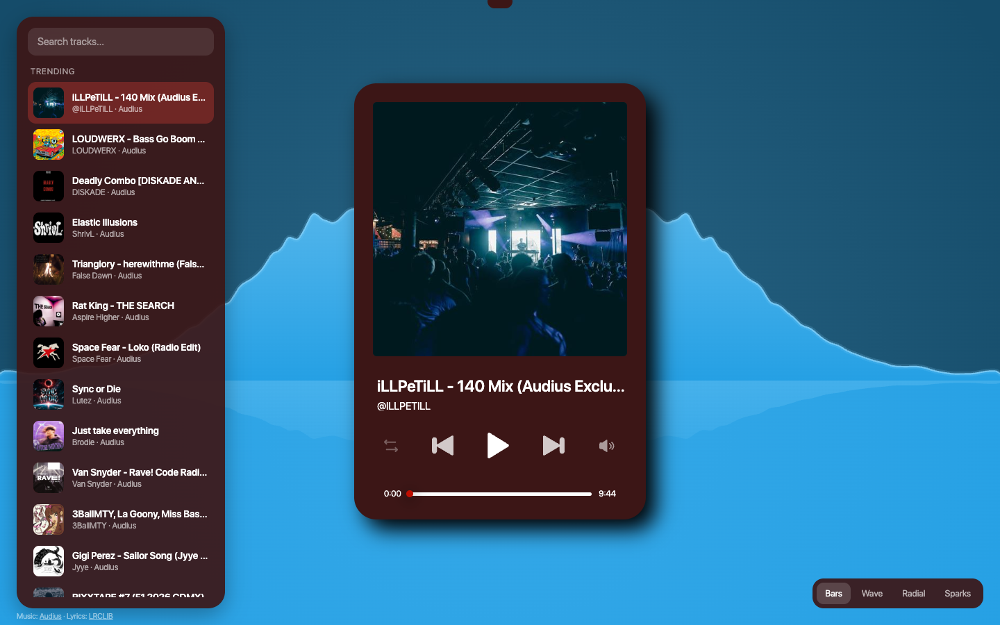
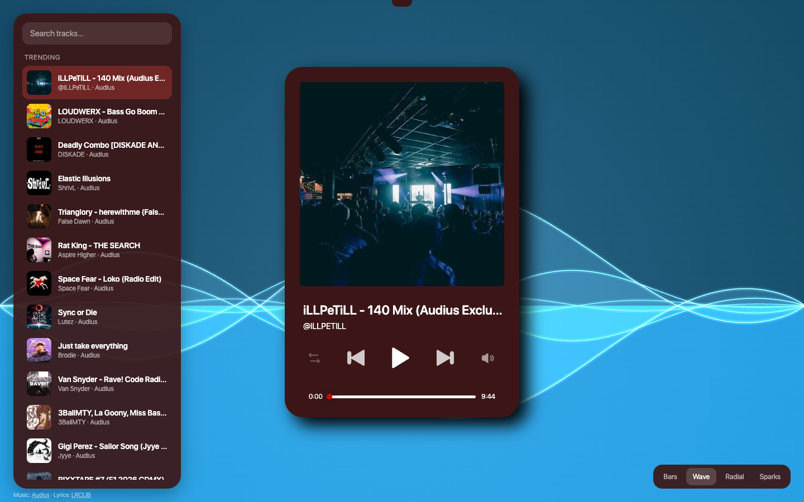
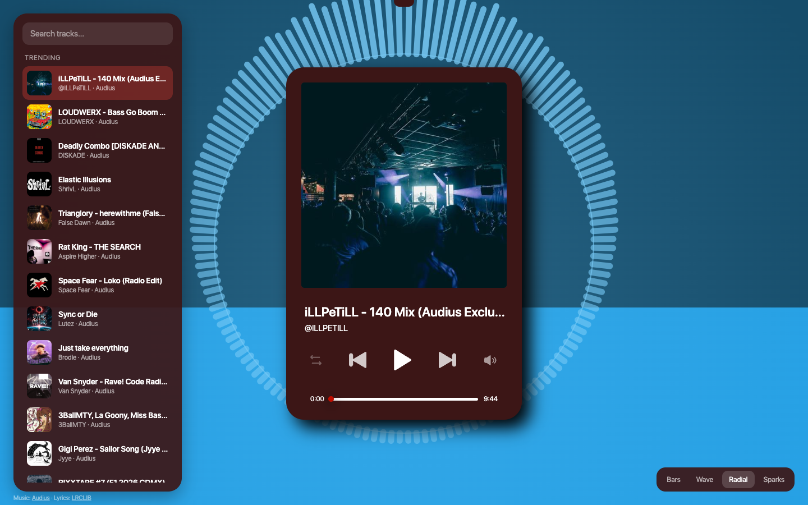
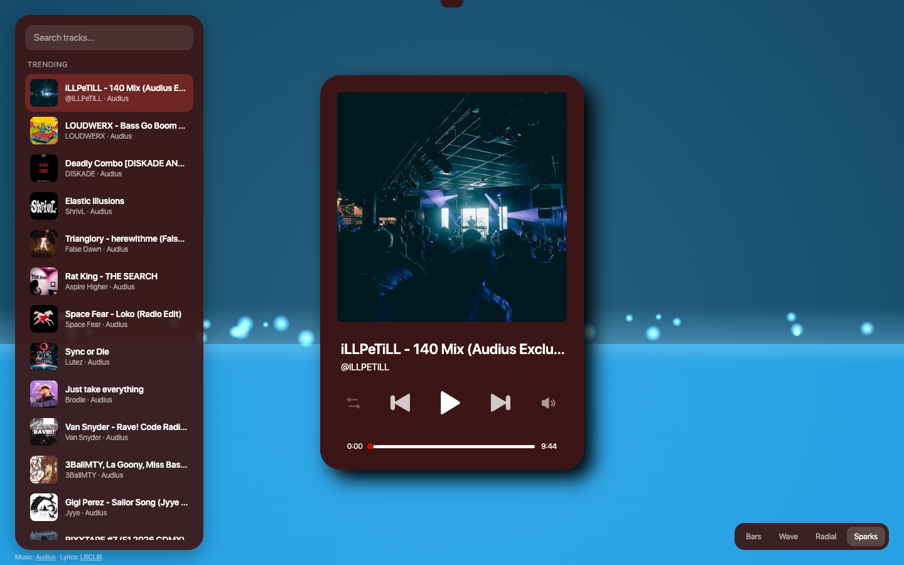

# JSplayer

A music player with a live audio visualizer. Vanilla JS, no build step, no dependencies.

Tracks, cover art and synced lyrics are streamed from free public APIs, so there are no media files in the repo.



## Visualizer modes

Switch with the buttons in the bottom right corner or the `V` key.

| Bars | Wave |
|---|---|
|  |  |
| **Radial** | **Sparks** |
|  |  |

The player card keeps its original design (see `Design.fig`). Everything around it is new.

## Features

- **Four visualizer modes**: smooth spectrum silhouette, layered waves, radial ring and a spark fountain
- **Colors from the album art**: the scene re-tints itself for every track
- **Beat detection**: the background pulses on bass hits, sparks fly on the beat
- **Search** across millions of tracks and a trending list
- **Synced lyrics** (karaoke style) when a match exists
- Shuffle, drag-to-seek, volume wheel, keyboard shortcuts, OS media keys
- Responsive: works on phones

## Run

No build needed. Serve the folder with any static server:

```bash
python3 -m http.server 8000
```

Open http://localhost:8000. Opening `index.html` directly also works.

Music starts only after a click: browsers block autoplay with sound.

## Data sources

| Source | What for | Key |
|---|---|---|
| [Audius](https://audius.co) | tracks, covers, search | not needed |
| [LRCLIB](https://lrclib.net) | synced lyrics | not needed |
| [Jamendo](https://developer.jamendo.com) (optional) | Creative Commons tracks | free `client_id` |

Jamendo is wired in but **off by default**: its audio server does not send CORS headers, so the browser can play those tracks but cannot analyse them, and the visualizer would stay silent. Audius works fully. To try Jamendo anyway, put your `client_id` into `config.js`.

## Keyboard

| Key | Action |
|---|---|
| `Space` | play / pause |
| `←` `→` | seek 5 s |
| `↑` `↓` or wheel over the speaker icon | volume |
| `N` / `P` | next / previous |
| `S` | shuffle |
| `M` | mute |
| `V` | next visualizer mode |
| `/` | focus search |

## How it works

- `api.js`: provider layer that normalizes every source to one track shape
- `visualizer.js`: canvas scene driven by a Web Audio `AnalyserNode` (log-spaced frequency bands, smoothing, bass-based beat detection, dominant hue extraction from cover art)
- `lyrics.js`: LRCLIB lookup and time-synced scrolling
- `script.js`: player logic and UI wiring
- `style.css`: the player card (original design); `ui.css`: everything around it

The Web Audio analyser needs CORS-enabled audio, which is why the audio source matters.

## Performance notes

The scene is drawn on a 1x canvas even on Retina screens and avoids `shadowBlur` and `backdrop-filter`: both were measured to drop the frame rate noticeably.

## Credits

Music streamed from Audius (artists keep their rights, check each track's terms). Lyrics by LRCLIB.
